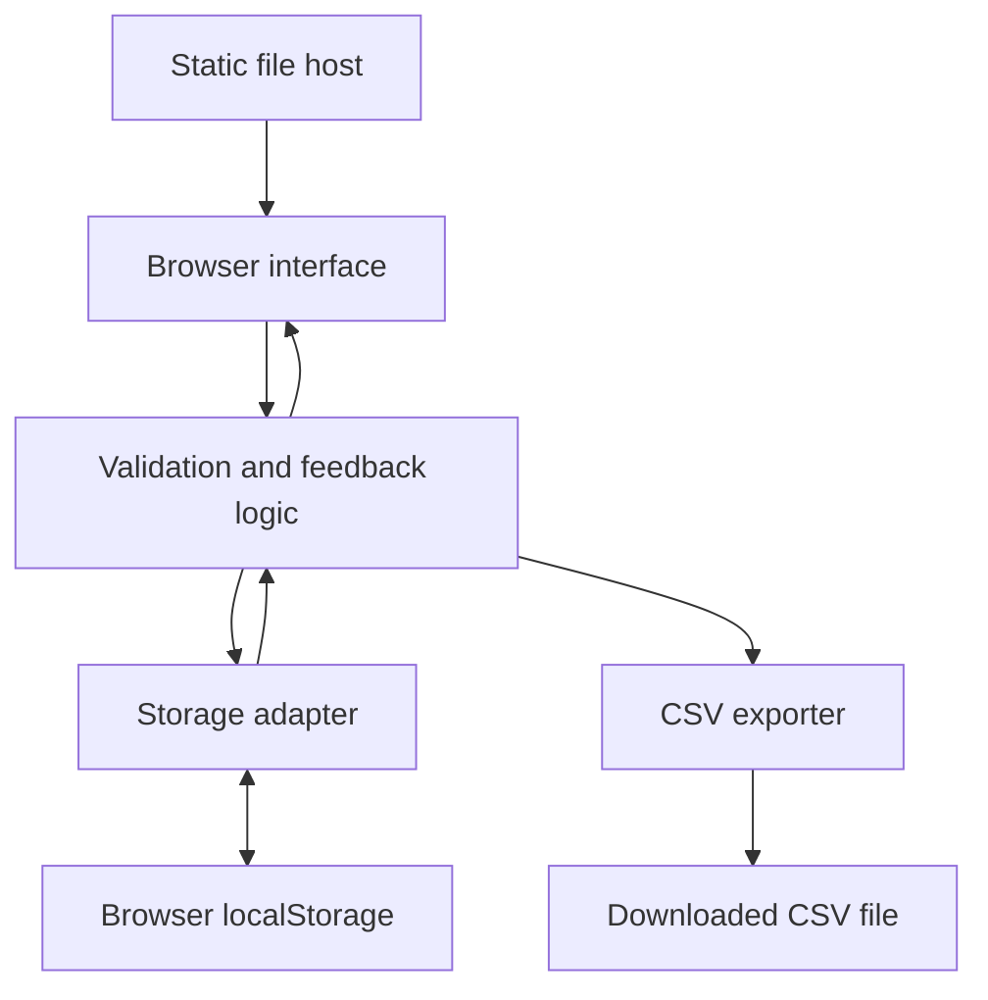

# Architecture - Feedback Hub

## Scope
A static, client-side HTML/CSS/JavaScript application. A static host serves its files; it receives no feedback data. There is no application server, authentication, database service, or external AI API. AI assists development only.

## High-Level System Diagram

## Responsibilities
| Component | Responsibility |
| --- | --- |
| Browser interface | Submission form, dashboard, filters, status controls, accessible success/error feedback |
| Feedback logic | Validate input, enforce the 100-entry limit, assign IDs/timestamps, derive sorted and filtered views |
| Storage adapter | Read, validate, and write the versioned JSON document; report failures without overwriting invalid data |
| CSV exporter | Serialize visible entries, escape CSV syntax, neutralize user-text formula prefixes, trigger download |
| Static host | Serve HTML, CSS, and JavaScript assets only |

## Main Flows
1. **Startup:** Read the storage key. A missing key means an empty collection. Parse and validate existing content before rendering. Invalid or unsupported content blocks mutations and produces an actionable error.
2. **Submission:** Trim and validate fields, check capacity, create ID/time/default status, build a candidate document, and persist it. Only after a successful write update displayed state and clear the form.
3. **Status change:** Validate the entry and target status, persist a candidate document, then update the interface. A failed write leaves the previous displayed status intact.
4. **Search/filter:** Derive a view from in-memory feedback. Combine filters using AND and sort newest first, with ID ascending for timestamp ties. Do not write view preferences to storage.
5. **Export:** Pass the derived view to the CSV exporter and download a local file. No network transmission occurs.

## Data and Failure Handling
The three logical entities are Feedback, Category, and Status; see [data_model.md](data_model.md). Category and Status are fixed reference data bundled with the app. Only Feedback records are persisted inside a versioned envelope.

Use one localStorage key so each save replaces the complete document in one operation. Catch read, parsing, validation, and write errors. Keep form content on failure and render user text as text, never executable HTML.

The supported MVP workflow uses one active tab. localStorage does not provide transactions across tabs; concurrent editing and conflict resolution are out of scope. Data is limited to the same browser profile and origin and can be lost when browser storage is cleared. This is a demo, not a shared team service.

## Verification Plan
Verify the acceptance criteria in [user_stories.md](user_stories.md), especially refresh persistence, status rollback on save failure, capacity, combined filters, CSV escaping, keyboard use, and mobile layout. These are planned checks, not claims that implementation or testing has already occurred.
