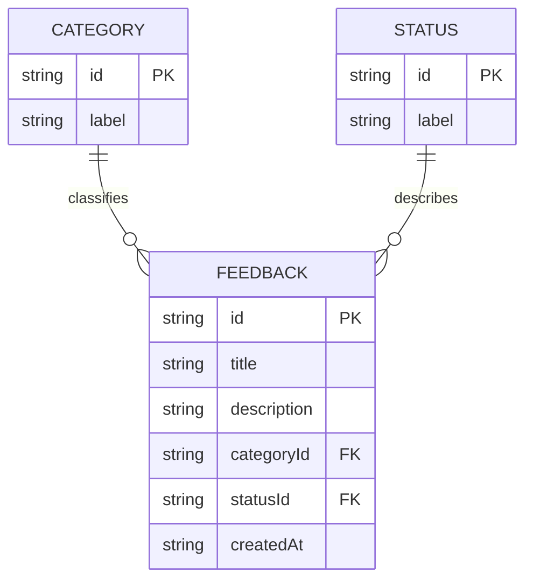

# Data Model - Feedback Hub

## Entity Relationships


Feedback, Category, and Status are three logical entities. Category and Status are immutable lookup collections bundled in JavaScript, not separately persisted tables. No User entity or personal contact details are needed because authentication is outside the MVP.

## Entity 1 - Feedback
| Field | Type | Required | Rules |
| --- | --- | --- | --- |
| id | string | Yes | Unique UUID generated with crypto.randomUUID(); immutable |
| title | string | Yes | Trimmed, 1-100 characters |
| description | string | Yes | Trimmed, 1-2000 characters |
| categoryId | string | Yes | Existing Category ID |
| statusId | string | Yes | Existing Status ID; defaults to new |
| createdAt | string | Yes | Valid UTC ISO 8601 timestamp, generated with new Date().toISOString(); immutable |

For consistent JavaScript validation, character limits count UTF-16 code units using string.length. On creation, check that the generated ID is not already present. Only statusId may change after creation.

## Entity 2 - Category
| id | label |
| --- | --- |
| bug | Bug |
| feature_request | Feature Request |
| general | General |

Both fields are required nonempty strings. IDs and labels are unique within this collection. Each Feedback references exactly one Category; a Category can classify zero or more entries. Categories cannot be created, edited, or deleted through the MVP interface.

## Entity 3 - Status
| id | label |
| --- | --- |
| new | New |
| under_review | Under Review |
| resolved | Resolved |

Both fields are required nonempty strings. Each Feedback references exactly one Status; a Status can describe zero or more entries. Any listed status may transition to any other listed status, including reopening a resolved entry. Status definitions cannot be changed through the MVP interface.

## Persistence Format
Storage key: `feedbackHub.v1`.

Persist one JSON document containing a schema version and feedback array. The envelope is a storage format, not a fourth business entity.

```json
{
  "schemaVersion": 1,
  "feedback": [
    {
      "id": "d9659d8e-07a9-45c6-a6f1-7d16e86d33e7",
      "title": "Improve keyboard navigation",
      "description": "Keep focus visible when moving between controls.",
      "categoryId": "feature_request",
      "statusId": "new",
      "createdAt": "2026-11-12T16:30:00.000Z"
    }
  ]
}
```

## Integrity and Capacity
- Maximum 100 Feedback records.
- Reject duplicate IDs, invalid field types or lengths, invalid timestamps, unknown category/status IDs, and unsupported schema versions when loading.
- A missing key represents zero entries. An invalid document must produce an error and block writes; never silently replace it with an empty collection.
- Validate a candidate document before saving. Only report success and update in-memory state after the storage write succeeds.
- No deletion, text editing, status history, or automatic migration is included in this MVP.
- Search text and selected filters are temporary UI state, not persisted entities.
- Storage contains fictional or non-sensitive demo data and is scoped to one browser profile and origin.

## CSV Mapping
| CSV column | Source |
| --- | --- |
| ID | Feedback.id |
| Title | Feedback.title |
| Description | Feedback.description |
| Category | Category.label resolved from categoryId |
| Status | Status.label resolved from statusId |
| Created At | Feedback.createdAt |

Export the current filtered view in displayed order. Quote every field and double embedded double quotes, preserving commas and line breaks. Before quoting user-controlled title and description, prefix an apostrophe if the value begins with =, +, -, @, tab, CR, or LF, or if its first non-whitespace character is =, +, -, or @. Do not modify the stored text. An empty view produces the header row only.
